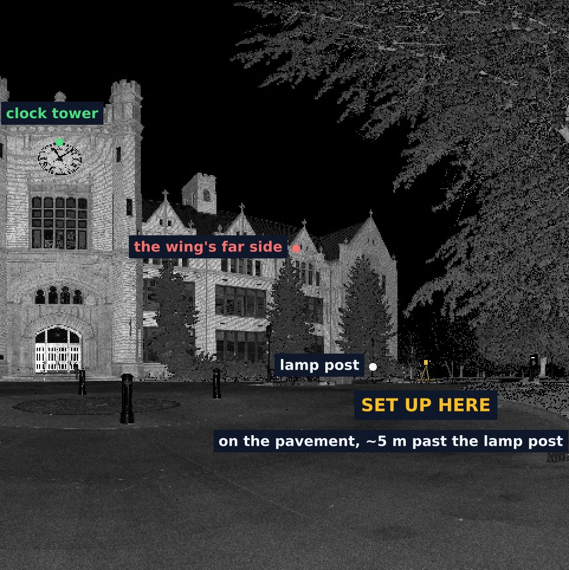

# trimble-x9-bridge

A bridge service for the **Trimble X9** laser scanner: the one program that
talks to the scanner, with one HTTP API every client uses — AI agents (through
an MCP server), a web UI, a CLI, scripts. The safety rules live in the
bridge, so no client can skip them.

Independent interoperability project, documented from the scanner's own
behavior ([PROVENANCE.md](PROVENANCE.md)). It contains no vendor code and is
**not affiliated with or endorsed by Trimble Inc.**; "Trimble" and "X9" are
trademarks of their respective owners.

<p align="center">
  
</p>

In the field the bridge runs on a Raspberry Pi on the tripod. The agent on
the laptop drives it through the MCP server over one USB-C cable; the laptop
keeps its own internet, and nothing routes through the Pi.

## What you get

A 19-station colour scan of an administration building, replayed through the
bridge: each station registered by itself as it landed, all of them
confirmed by the audit, every pair of stations within about 22 mm.

<table>
<tr>
<td width="33%"></td>
<td width="33%"></td>
<td width="33%"></td>
</tr>
<tr>
<td valign="top"><b>Registered plan</b>: every station in one frame, from
above, each with a verdict from independent checks
(<code>scanner_registration</code>).</td>
<td valign="top"><b>Minimap</b>, redrawn after every station: building
walls, low walls and vegetation, and the stations by number. In the chat
(<code>scanner_minimap</code>) and the web UI.</td>
<td valign="top"><b>Coverage</b> of one station: point spacing, and what
the scanner saw and where it was blocked. The agent looks at it before
proposing the next station.</td>
</tr>
</table>

### Where to set up next

<table>
<tr>
<td width="50%"></td>
<td width="50%"></td>
</tr>
<tr>
<td valign="top"><b>The plan</b>, from the station's own points: ground,
things standing at body height, canopy. It tries every spot a person can
walk to, casts rays from each, and picks the one that sees the most of what
this station couldn't while sharing enough surface to register
(<code>scanner_plan_station</code>).</td>
<td valign="top"><b>The proposal</b> on the person's view: the pick, the
landmark beside it, one sentence. The bridge reads the ground there from
the scan and draws the tripod its real size where it will stand, with its
shadow on the pavement (<code>scanner_propose_station</code>).</td>
</tr>
</table>

## Build a field kit

<p align="center">
  
</p>

From a fresh Raspberry Pi to an acceptance scan in seven layers, each with a
check: [ops/README.md](ops/README.md). An agent can follow it; three steps
need a person at the kit.

## What it does

- **Scans:** full-dome and area scans, queued one at a time, with phases
  (leveling, sweep, color) and timings reported live.
- **Rules every client is subject to:** connection, battery, storage, a busy
  scanner, a single queue, known scan modes, and an echo check that cancels a
  scan the scanner didn't accept as sent.
- **Approvals:** tokens with roles `viewer`, `agent`, `operator`, `admin`. An
  agent's scans wait for a person's approval unless an operator granted a set
  of scans (optionally limited to one recipe run). Deletes need an operator and
  an explicit confirmation.
- **Aiming:** a box drawn on a scan's preview becomes an area-scan window.
- **Exports:** levelled PLY, LAS or COPC (Cloud Optimized Point Cloud) via
  [trimble-tzf](https://github.com/northidaholabs/trimble-tzf), with automatic
  checks (point count, levelled, coordinates).
- **Missions:** the person's goal for the job, the agent's done-when
  criteria and a ledger of targets (each facade, each window): covered,
  measured or declined. "Ready to leave" is refused while anything is open;
  the person signs the job off once. Saved across restarts.
- **Registration:** after every full dome the bridge brings the station
  into the project frame by itself (4-DOF: the X9 levels its scans), adjusts
  all stations together so loops close, finds the walls in the merged plan,
  and judges how much of any wall face has been seen. Mission targets on
  walls are then covered by geometry, not by eye. Every station gets a
  verdict from independent checks; a field laptop can do the work for the
  Pi (`x9-bridge worker`), with the Pi as the fallback.
- **Next-station proposals:** the agent marks where to set up next on the
  station's preview (a tripod on the ground, labels for what was seen and
  what is hidden, landmarks to walk by) with directions in prose; the bridge
  draws the picture and shows it in the web UI.
- **Viewing and coverage:** thinned points for a browser viewer, and each
  scan's coverage: point spacing and a plan of what the scanner saw and where
  it was blocked (shadows), as JSON and an image an agent can look at.
- **Recipes and runs:** TOML recipes of `action`, `person` and `check` steps;
  a run executes them under the starter's role.
- **Field log** and a live event stream.
- **Measurements:** a window's finished opening from a close-up, with an
  uncertainty, checks and an evidence image, as a job or a recipe step.
- **Proposals:** the agent answers a person step (finds the window, measures it)
  and a person confirms it with one click.
- **Web UI** at `/ui/`: approvals, live progress, recipe runs with box
  drawing on previews, aiming, exports, the log, and a 3D point viewer with
  the coverage overlay that follows each new scan while you are still on site.

## Documentation

| Document | What |
| --- | --- |
| [docs/guide.md](docs/guide.md) | Install, configuration, tokens and roles, every workflow with `curl` examples (scans, approvals, grants, cancel, aiming, exports, viewing and coverage, deletes, field log, events), and the web UI |
| [docs/recipes.md](docs/recipes.md) | Recipe format v0 and how runs execute |
| [docs/errors.md](docs/errors.md) | Every error `code`, its HTTP status, when it happens and its hint |
| [docs/tools.md](docs/tools.md) | The `x9` CLI, the `x9-mock` simulator, and the tests |
| [api/bridge-v1.openapi.yaml](https://github.com/northidaholabs/trimble-x9-bridge/blob/main/api/bridge-v1.openapi.yaml) | The API spec (OpenAPI 3.1; planned parts marked `x-status: planned`) |
| [docs/bridge-api-v1.md](docs/bridge-api-v1.md) | Design notes and what was tested on a real X9 |
| [ops/README.md](ops/README.md) | Building a field kit from a fresh Raspberry Pi: the USB-C link, the scanner links, the bridge service, the MCP server, the laptop |
| [PROVENANCE.md](PROVENANCE.md) | How the scanner API knowledge was obtained |

## Layout

| Path | What |
| --- | --- |
| `crates/x9-bridge` | The bridge service (Rust, axum) |
| `crates/x9-client` | Client for the scanner's HTTP API |
| `crates/x9-mock` | Scanner simulator: scans with realistic phases, area scans, cancel, failure modes |
| `crates/x9-cli` | Small CLI over the client |
| `ops/` | The field-kit build: the bridge service and launcher, the USB-C gadget, NetworkManager profiles, the scanner Wi-Fi preference, and `x9-netctl` for desk machines |

## Install

Release builds for Linux x86_64 and aarch64 (Raspberry Pi 4/5) and macOS (for
laptop workers) are on the
[releases page](https://github.com/northidaholabs/trimble-x9-bridge/releases): each
archive has `x9-bridge`, `x9-mock`, the `x9` CLI, `ops/` (the field-kit build) and `docs/`.

## Try it against the simulator

```bash
cargo build --release
target/release/x9-mock &                                   # simulator on 127.0.0.1:34567
printf 'me operator %s\n' "$(openssl rand -hex 16)" > tokens
X9_BASE=http://127.0.0.1:34567/api/v1 BRIDGE_TOKENS=tokens target/release/x9-bridge   # API on 127.0.0.1:8795/v1
```

Against a real scanner, point `X9_BASE` at it: `http://192.168.42.1:34567/api/v1`
over USB, or `http://192.168.43.1:34567/api/v1` on its Wi-Fi.

## Tests

```bash
cargo test                                   # rules, grants, aiming, recipes, echo check
python3 crates/x9-bridge/tests/e2e.py target/release
```

The end-to-end test starts the simulator and the bridge and checks the main
flows. With `E2E_FIXTURES` pointing at a directory of real scans
(`dome.tzf`/`.jpg`, `area.tzf`/`.jpg`) it also checks previews, aiming,
exports and a full recipe run.

## Agents

[TrimbleX9-mcp](https://github.com/northidaholabs/TrimbleX9-mcp) has a bridge mode
(`SCANNER_BRIDGE_URL`, `SCANNER_BRIDGE_TOKEN`) that exposes this API as MCP
tools, with previews returned as images and recipes as a prompt.

## Status

Version 0.13.0: the API is a draft, tested against the simulator and on a real X9
(scans, measurements, multi-station registration, laptop workers). To build a
field kit from a fresh Raspberry Pi, see [ops/README.md](ops/README.md).

## License

[MIT](LICENSE). Copyright (c) 2026 North Idaho Labs.
"Trimble" and "X9" are trademarks of Trimble Inc.; the non-affiliation note is in [NOTICE](NOTICE).
