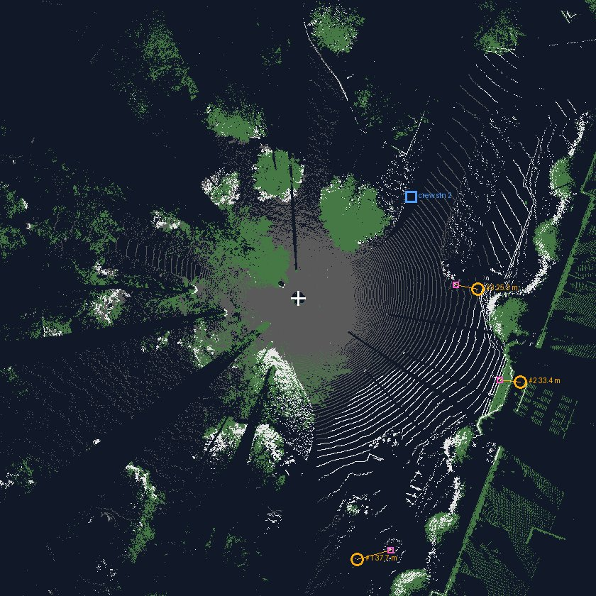

# x9-bridge guide

This guide is for people who install, run and use the bridge. It covers
installation, configuration, tokens and roles, and the everyday workflows,
with `curl` examples. Every statement here describes what the code in
`crates/x9-bridge` does today.

Related documents:

- [recipes.md](recipes.md): the recipe format and how runs execute.
- [errors.md](errors.md): every error `code` the bridge returns.
- [tools.md](tools.md): the `x9` CLI, the `x9-mock` simulator and the tests.
- [../api/bridge-v1.openapi.yaml](../api/bridge-v1.openapi.yaml): the API spec.
- [bridge-api-v1.md](bridge-api-v1.md): design notes and test history.

## Contents

1. [What the bridge is](#what-the-bridge-is)
2. [Install](#install)
3. [Configuration](#configuration)
4. [Tokens](#tokens)
5. [Roles](#roles)
6. [Conventions](#conventions)
7. [Workflows](#workflows)
8. [Web UI](#web-ui)
9. [Events](#events)
10. [Data directory and state](#data-directory-and-state)

## What the bridge is

The bridge is the one program that talks to the scanner. It runs on the
computer next to the scanner (a Raspberry Pi on the tripod, or a desktop at
the bench). It reaches the scanner API over USB or over the scanner's own
Wi-Fi, and it serves an HTTP API at `/v1` to every client: AI agents through
an MCP server, a web UI, scripts, `curl`.

The safety rules live in the bridge, so no client can skip them: battery,
storage, a busy scanner, a single scan queue, known scan modes, approvals for
agents, confirmed deletes, and an echo check that stops a scan the scanner did
not accept as sent.

## Install

### Release archives

Tagged releases have archives for Linux `x86_64` and `aarch64` (Raspberry Pi
4/5), and for macOS (`aarch64-apple-darwin`, `x86_64-apple-darwin`, for laptop
workers), on the
[releases page](https://github.com/northidaholabs/trimble-x9-bridge/releases).
Each archive is named `trimble-x9-bridge-<tag>-<target>.tar.gz` and comes with
a `.sha256` file. It contains:

| File | What |
| --- | --- |
| `x9-bridge` | The bridge service |
| `x9-mock` | The scanner simulator ([tools.md](tools.md#x9-mock)) |
| `x9` | A small CLI over the scanner API ([tools.md](tools.md#the-x9-cli)) |
| `ops/` | The field-kit build: the bridge service and launcher, the USB-C gadget, NetworkManager profiles, the scanner Wi-Fi preference, `env.example` and `README.md` (a step-by-step build of a field Pi) |
| `docs/` | This guide and the other docs |
| `README.md`, `PROVENANCE.md`, `LICENSE`, `NOTICE` | |

```bash
tag=v0.14.0; target=aarch64-unknown-linux-gnu
curl -LO https://github.com/northidaholabs/trimble-x9-bridge/releases/download/$tag/trimble-x9-bridge-$tag-$target.tar.gz
curl -LO https://github.com/northidaholabs/trimble-x9-bridge/releases/download/$tag/trimble-x9-bridge-$tag-$target.tar.gz.sha256
sha256sum -c trimble-x9-bridge-$tag-$target.tar.gz.sha256
tar xzf trimble-x9-bridge-$tag-$target.tar.gz
```

### Build from source

You need a stable Rust toolchain. The build fetches the public
[trimble-tzf](https://github.com/northidaholabs/trimble-tzf) decoder from GitHub.

```bash
git clone https://github.com/northidaholabs/trimble-x9-bridge
cd trimble-x9-bridge
cargo build --release          # target/release/{x9-bridge,x9-mock,x9}
```

### First run

The bridge refuses to start without a token file (see [Tokens](#tokens)).

```bash
printf 'me operator %s\n' "$(openssl rand -hex 16)" > tokens
chmod 600 tokens
X9_BASE=http://192.168.42.1:34567/api/v1 BRIDGE_TOKENS=tokens ./x9-bridge
# x9-bridge 0.12.0 listening on http://127.0.0.1:8795/v1 (scanner http://192.168.42.1:34567/api/v1)
```

To try it without a scanner, start `x9-mock` first and point `X9_BASE` at it
(`http://127.0.0.1:34567/api/v1`). See [tools.md](tools.md#x9-mock).

On startup the bridge creates `BRIDGE_DATA` and `BRIDGE_RECIPES` if they are
missing, loads the recipes, writes a `rule` entry to the field log
("Bridge … started; scanner at …"), and prints how many recipes it loaded and
skipped. It stops cleanly on Ctrl-C (SIGINT).

The bridge starts even when the scanner is unreachable. `GET /status` then
shows `"connected": false`, and anything that needs the scanner fails with
`scanner_disconnected`.

### Running as a systemd service

`ops/x9-bridge.service` runs the bridge with a throwaway user
(`DynamicUser=yes`), a read-only system (`ProtectSystem=strict`,
`ProtectHome=yes`) and `/var/lib/x9-bridge` as its only writable place
(`StateDirectory=x9-bridge`, `BRIDGE_DATA=/var/lib/x9-bridge`). The token file
is passed as a systemd credential (`LoadCredential=tokens:/etc/x9-bridge/tokens`),
so the bridge never reads `/etc/x9-bridge` itself. It restarts on failure
after 5 s.

```bash
sudo install -D -m 0755 x9-bridge ops/x9-bridge-run -t /opt/x9-bridge/
sudo install -D -m 0600 tokens /etc/x9-bridge/tokens
sudo install -m 0644 ops/x9-bridge.service /etc/systemd/system/
sudo systemctl enable --now x9-bridge
journalctl -u x9-bridge -f
```

The unit starts `x9-bridge-run`, a small wrapper that:

- picks the scanner link when `X9_BASE` is not set: USB
  (`http://192.168.42.1:34567/api/v1`) if `GET /tasks` answers within 2 s,
  else the scanner's Wi-Fi (`http://192.168.43.1:34567/api/v1`), else USB;
- sets `BRIDGE_TOKENS` to `$CREDENTIALS_DIRECTORY/tokens` when it is not set;
- runs `x9-bridge` from its own directory.

Put overrides (`X9_BASE`, `BRIDGE_ADDR`, `BRIDGE_POLL_MS`, …) in
`/etc/x9-bridge/env`, one `NAME=value` per line. The file is optional.

The link is chosen only at start. With NetworkManager, the dispatcher hook
`ops/90-x9-bridge` runs `systemctl try-restart x9-bridge.service` whenever a
connection named in `X9_NM_CONNECTIONS` comes up (default `x9-usb x9-wifi`;
edit the script to match your profile names):

```bash
sudo install -m 0755 ops/90-x9-bridge /etc/NetworkManager/dispatcher.d/
```

### The USB link

Linux binds the scanner's USB port as a network device (usually `cdc_eem`) and
gets an address on 192.168.42.0/24 by DHCP. `ops/x9-netctl` is a small
privileged helper that brings this link up isolated: never a default route,
never the scanner's DNS, a high route metric. Its verbs `usb-up`, `usb-info`
and `usb-down` manage that link; the others manage the uplink of the machine
it was written on, so review the defaults at the top before use. See
[../ops/README.md](../ops/README.md) for installing it with a narrow sudo rule.

## Configuration

All configuration is by environment variable. Nothing else is read at startup
except the token file and the recipe directory.

| Variable | Default | What |
| --- | --- | --- |
| `X9_BASE` | `http://192.168.42.1:34567/api/v1` | The scanner API base URL. USB is `192.168.42.1`, the scanner's Wi-Fi is `192.168.43.1`, the simulator is `127.0.0.1:34567` by default. |
| `BRIDGE_ADDR` | `127.0.0.1:8795` | Listen address. The API is served under `/v1`. Use `0.0.0.0:8795` (or a specific interface address) to reach it from other machines. |
| `BRIDGE_TOKENS` | none; **required** | Path to the token file. The bridge exits if it is unset, unreadable, malformed or empty. |
| `BRIDGE_DATA` | `$HOME/.local/share/x9-bridge` (`./.local/share/x9-bridge` if `HOME` is unset) | Cache for scan files, previews and exports. Created if missing. |
| `BRIDGE_RECIPES` | `$BRIDGE_DATA/recipes` | Directory of recipe files (`*.toml`). Created if missing. Read again on every recipe request, so new files need no restart. |
| `BRIDGE_POLL_MS` | `1000` | How often, in milliseconds, the worker polls the scanner while a scan runs, while it waits for the scanner to go idle, and after a cancel. Must be a whole number. |

`BRIDGE_POLL_MS` also scales two timeouts: a scan counts as done once the
scanner has been idle for 3 polls with the scan file in hand, and fails if the
scanner goes idle for 10 polls without filing a scan.

Fixed limits (not configurable):

| Limit | Value |
| --- | --- |
| Longest scan before the job fails | 45 minutes |
| Consecutive failed scanner polls before a running scan job fails | 10 |
| Wait for a task the bridge cancelled to clear | 60 s |
| Event buffer per client | 256 events |

### Rules

The rule settings are fixed at their defaults in this version. Anyone with a
token can read them:

```bash
curl -s -H "Authorization: Bearer $TOKEN" http://127.0.0.1:8795/v1/rules
```

| Rule | Default | Effect |
| --- | --- | --- |
| `min_battery_pct_to_scan` | `15` | Scans are refused (`battery_low`) below this, unless the scanner is on AC power. |
| `min_storage_free_bytes` | `2000000000` | Scans are refused (`storage_low`) when the scanner's card has less free space. |
| `require_approval_for_scans` | `true` | Scans from `agent` tokens wait for approval unless a grant covers them. |
| `refuse_aim_after_move` | `true` | `POST /aim` is refused (`instrument_moved`) when the scanner reports it moved since its last scan. |
| `max_queue_length` | `20` | Scan requests are refused (`conflict`) when this many scan jobs are already queued or awaiting approval. |

Battery and storage are checked only when the scanner reports them. They are
checked at admission and again right before the scanner starts.

## Tokens

The token file has one token per line:

```text
# name    role      token
crew      operator  4f1c0d8e9b2a7f3c5e6d1a0b9c8d7e6f
agent-1   agent     9a8b7c6d5e4f3a2b1c0d9e8f7a6b5c4d
wall      viewer    0123456789abcdef0123456789abcdef
```

Rules for the file:

- Blank lines and lines that start with `#` (after leading spaces) are skipped.
  A `#` later in a line is not a comment.
- Every other line must have exactly three fields separated by whitespace:
  `name role token`. Anything else stops the bridge with an error naming the
  file and line ("expected \`name role token\`").
- `role` is one of `viewer`, `agent`, `operator`, `admin`, lower case. An
  unknown role stops the bridge.
- `token` must be at least 16 characters. A shorter one stops the bridge.
  `openssl rand -hex 16` gives 32 characters.
- The file must hold at least one token.
- `name` is what the bridge records as the author of log entries, as
  `requested_by` on jobs, `granted_by` on grants and `started_by` on runs.
  Names need not be unique. If the same token appears twice, the later line
  wins.
- The file is read once at startup. Restart the bridge to change tokens.

Clients send the token as `Authorization: Bearer <token>` (the word `Bearer`
with a capital B and one space). Every route except `GET /health` needs a
valid token; a missing or unknown token gets `401 unauthorized`.

## Roles

| Action | `viewer` | `agent` | `operator` | `admin` |
| --- | --- | --- | --- | --- |
| Read: status, rules, scan modes, projects, scans, previews, scan files, jobs, grants, exports, recipes, runs, log, events | yes | yes | yes | yes |
| Turn a preview box into a window (`POST /aim`) | yes | yes | yes | yes |
| Create a project | no | yes | yes | yes |
| Queue a scan | no | yes; waits for approval unless a grant covers it | yes, queued at once | yes, queued at once |
| Cancel a job | no | only jobs it requested (same token name) | any job | any job |
| Approve a job | no | no | yes | yes |
| Create or revoke a grant | no | no | yes | yes |
| Start an export | no | yes | yes | yes |
| Add a log note | no | yes | yes | yes |
| Start a recipe run | no | yes | yes | yes |
| Advance or cancel a recipe run | no | only runs it started (same token name) | any run | any run |
| Delete a scan | no | no | yes, with `X-Confirm` | yes, with `X-Confirm` |

`admin` has exactly the rights of `operator` in this version. Changing rules
and tokens over the API is not implemented.

A typical setup: an AI agent gets an `agent` token, the person in the web UI gets
an `operator` token. The person grants "up to 12 scans in this project for two
hours", and the agent works inside that.

## Conventions

- Base URL: `http://127.0.0.1:8795/v1` with the default `BRIDGE_ADDR`.
- JSON, `snake_case`. Request bodies are parsed as JSON whatever the
  `Content-Type`; unknown fields are ignored.
- Lengths in metres, angles in radians, times in RFC 3339 UTC
  (`2026-10-20T12:40:00Z`), durations in seconds.
- `ha` is the scanner's horizontal angle (clockwise seen from above,
  `[0, 2π)`). `va` is the vertical angle from the zenith (`0` is straight up,
  `π` straight down).
- Ids are made by the bridge with a readable prefix: `job_…`, `grant_…`,
  `exp_…`, `run_…`, `log_…`. Projects and scans use the scanner's own UUIDs
  (`project_id`, `scan_id`); the scanner's numeric scan ids shift when a scan
  is deleted, so the bridge never exposes them.
- Long work (scans, exports) answers `202 Accepted` with a `Job`. Follow it
  with `GET /jobs/{job_id}` or the [event stream](#events).
- Errors are `application/problem+json` (RFC 9457) with a `code`; see
  [errors.md](errors.md).

The examples below assume:

```bash
B=http://127.0.0.1:8795/v1
TOKEN=...      # an operator token unless stated
AGENT=...      # an agent token
H="Authorization: Bearer $TOKEN"
```

## Workflows

### Check the bridge and the scanner

```bash
curl -s $B/health
# {"ok":true,"version":"0.12.0"}

curl -s -H "$H" $B/status
```

```json
{
  "bridge": {"version": "0.12.0", "started_at": "2026-10-20T12:00:00Z",
             "queue_length": 0, "worker_ready": false},
  "scanner": {
    "connected": true,
    "busy": false,
    "current_job_id": null,
    "battery_pct": 87,
    "on_ac_power": false,
    "storage_free_bytes": 24356585472,
    "moved_since_last_scan": false,
    "leveling": {"state": "ok", "compensator_on": true, "tilt_rad": [0.0155, 0.023]}
  }
}
```

| Field | Meaning |
| --- | --- |
| `bridge.queue_length` | Scan jobs `queued` or `awaiting_approval` |
| `bridge.worker_ready` | Reserved; always `false`. Measurement runs in the bridge itself, and laptop workers are listed by `GET /v1/workers`. |
| `scanner.connected` | `false` when the scanner did not answer. The other scanner fields are then missing. |
| `scanner.busy` | The scanner reports a current task (from any client) |
| `scanner.current_job_id` | The bridge's scan job in state `running`, if any. Exports run beside the scanner and never show here. |
| `scanner.leveling.state` | `ok`, `none`, `error`, or `in_progress` for any other value the scanner reports |
| `scanner.leveling.tilt_rad` | The two compensator readings, radians (`0` when missing) |

Scan modes, with the scanner's own figures:

```bash
curl -s -H "$H" $B/scan-modes
# [{"mode":"STD_L0","range_m":30,"angular_step_rad":0.00150796,"points_full_dome":6799768,
#   "fixed_seconds":38,"full_dome_seconds":50}, ...]
```

`fixed_seconds` is the overhead every scan pays; `full_dome_seconds` is the
scanner's estimate for a full dome with color off.

### Create and list projects

```bash
curl -s -H "$H" -d '{"name":"kitchen"}' $B/projects
# 201 {"project_id":"<uuid>","name":"kitchen","scan_count":0}

curl -s -H "$H" $B/projects
PROJECT=<the project_id>
```

- `name` is trimmed, must be 1–64 bytes and must not contain `/`.
- A name that already exists on the scanner is `409 conflict`.
- The bridge generates the project UUID.
- `scan_count` is the number of stations (full-dome scans) the scanner has
  numbered in the project; area scans are not counted.
- Creating a project writes a `note` to the field log.

### Start a full-dome scan

```bash
curl -s -H "$H" -d "{\"project_id\":\"$PROJECT\",\"kind\":\"full_dome\",\"mode\":\"STD_L0\",\"note\":\"station 1\"}" $B/scans
```

```json
{"job_id": "job_3f9a1c2b7d4e", "kind": "scan", "state": "queued",
 "requested_by": "crew", "run_id": null, "created_at": "2026-10-20T12:01:00Z",
 "started_at": null, "finished_at": null}
```

Request fields:

| Field | Required | What |
| --- | --- | --- |
| `project_id` | yes | A project on the scanner (`404 not_found` otherwise) |
| `kind` | yes | `full_dome` or `area` |
| `mode` | yes | A mode name from `GET /scan-modes` (`400 invalid_request` lists the valid ones) |
| `color` | no, default `false` | Camera images after the sweep. Adds about 150 s per scan. |
| `window` | for `area` only | See below. A full dome with a window is refused. |
| `note` | no | Added to the "scan requested" log entry |

How a scan request is admitted, in order:

1. The request is validated (mode not empty; window rules).
2. The mode must be one the scanner lists. This asks the scanner, so an
   unreachable scanner gives `503 scanner_disconnected` here.
3. The project must exist on the scanner.
4. Viewers are refused (`403 forbidden`). The role is checked first, so a
   viewer gets `forbidden` even for a malformed request.
5. Connected, battery and storage rules (see [Rules](#rules)).
6. The queue must have room (`max_queue_length`).
7. An `agent` scan not covered by a grant is held as `awaiting_approval`.
   Everything else is `queued`.

Queued scans run one at a time, oldest first. Right before the scanner starts,
the worker checks connected, battery and storage again, and checks that the
scanner is idle:

- If the scanner lists a task the bridge did not start (another client is
  driving it), the job fails at once with `scanner_busy`.
- If it lists only a task the bridge itself cancelled, the job waits for it
  to clear, up to 60 s, and logs "Waiting for the scanner to clear the
  cancelled task". After 60 s the job fails with `scanner_busy`. While it
  waits, the job reads `running` with phase `waiting`, then `leveling` once
  the scanner is clear.

Then the bridge sends the scan and compares the scanner's echo of the request
with what it sent. The scanner answers `202` even when it cannot parse a
request and then runs a default full dome. On any difference the bridge
cancels the scanner's task at once and the job fails with `conflict`
("the scanner did not accept the request as sent (…); its task was cancelled").

Follow the job:

```bash
curl -s -H "$H" $B/jobs/job_3f9a1c2b7d4e
```

| `state` | Meaning |
| --- | --- |
| `awaiting_approval` | An agent's scan waiting for an operator |
| `queued` | Waiting its turn |
| `running` | The worker has it |
| `succeeded` | Done. `result` is `{"scan_id": "<uuid>"}` (exports: `{"export_id": "exp_…"}`) |
| `failed` | `problem` holds the error (a problem document, see [errors.md](errors.md)) |
| `cancelled` | Cancelled; see [Cancel a job](#cancel-a-job) |

| `phase` | Meaning |
| --- | --- |
| `waiting` | Claimed, but the scanner still lists a task the bridge cancelled; the job waits for it to clear |
| `leveling` | Claimed and about to start, or the scanner is levelling (its task is not yet `running`) |
| `sweeping` | The laser sweep; also the few seconds after the file appears with color off |
| `imaging` | Color images, after the scan file appeared (color on only) |
| `downloading`, `decoding` | Export jobs |

`progress` is the scanner's own task percentage (0–1): it climbs to 1 during
the sweep, then starts again in steps of 1/30 during color imaging. It is set
to `1` when the job succeeds. `phase` is removed when a job finishes.

`GET /jobs` lists every job since the bridge started, newest first.

When the scan is done, read the scan record:

```bash
curl -s -H "$H" $B/scans/$SCAN
```

```json
{"scan_id": "<uuid>", "project_id": "<uuid>", "parent_scan_id": null, "station": 1,
 "kind": "full_dome", "mode": "STD_L0", "color": false,
 "created_at": "2026-10-20T12:01:00Z", "point_count": 6492453, "tzf_bytes": 58432077,
 "timings": {"leveling_s": 62.5, "sweep_s": 30.9, "geometry_ready_s": 93.4, "done_s": 100.9}}
```

- `GET /scans` lists all scans on the scanner, newest first;
  `?project_id=<uuid>` filters to one project.
- `kind` and `station` come from the scanner's file name: `N.tzf` is the
  full-dome scan of station `N`, `N_k.tzf` is area scan `k` of station `N`,
  and its `parent_scan_id` is station `N`'s scan.
- `created_at`, `timings` and `window` are known only for scans this bridge
  ran since it started; the scanner does not record them. `created_at` is
  when the job started.
- `timings` are seconds from the moment the bridge sent the scan:
  `leveling_s` when the task first reads `running`, `geometry_ready_s` when the
  scan file appeared, `sweep_s` the difference, `done_s` when the job ended.

### Start an area scan

An area scan covers a window of the dome:

```bash
curl -s -H "$H" -d "{\"project_id\":\"$PROJECT\",\"kind\":\"area\",\"mode\":\"STD_L2\",
  \"window\":{\"start_ha\":5.157,\"delta_ha\":0.456,\"start_va\":1.262,\"delta_va\":0.441}}" $B/scans
```

Window rules (else `400 invalid_request`):

- `0 ≤ start_ha < 2π`, `0 < delta_ha ≤ 2π`. The window may cross the `2π`
  seam: `start_ha + delta_ha` can exceed `2π`.
- `0 ≤ start_va ≤ π`, `delta_va > 0`, `start_va + delta_va ≤ π`.

The scanner files an area scan under the latest station of the project, even
when that station's full dome was cancelled. Use [aiming](#previews-and-aiming)
to get a window from a box drawn on a preview.

### Approvals: an agent's scan

```bash
# The agent asks.
curl -s -H "Authorization: Bearer $AGENT" \
  -d "{\"project_id\":\"$PROJECT\",\"kind\":\"full_dome\",\"mode\":\"STD_L0\"}" $B/scans
# 202 {"job_id":"job_…","state":"awaiting_approval",...}

# An operator sees it (GET /jobs, the event stream, or the field log) and approves.
curl -s -X POST -H "$H" $B/jobs/$JOB/approve
# 200 {"job_id":"job_…","state":"queued",...}
```

- A job from a recipe run (it has `run_id`) can be approved with the run's
  later scans in one go: send `{"run": true}`. The bridge grants that run the
  scans it may still start, for 2 hours (see
  [recipes.md](recipes.md#waiting-for-approval)). The web UI offers **Approve
  the run** and **Only this scan**.
- Only `operator` and `admin` can approve (`403 forbidden` otherwise).
- Only a job in `awaiting_approval` can be approved (`409 conflict`
  otherwise, for example "job is queued, not awaiting approval").
- Approval writes an `approval` entry to the field log. The rules are checked
  again when the job starts, not at approval.
- To refuse a job, cancel it.
- A job waits for approval indefinitely; there is no timeout.

### Grants: standing approval for an agent

A grant lets an agent's scans queue without asking, within limits. In the
web UI an operator gives one from the Scans tab: **Let agents scan here for 4
hours (up to 12 scans)** for the chosen project, with **Revoke** beside an
active one. Given once at setup, it is what lets a recipe run ask a person
only for the final sign-off.

```bash
curl -s -H "$H" -d "{\"project_id\":\"$PROJECT\",\"expires_at\":\"2026-10-20T16:00:00Z\",
  \"max_scans\":12,\"allowed_modes\":[\"STD_L0\",\"STD_L2\"],\"allow_color\":false}" $B/grants
```

```json
{"project_id": "<uuid>", "expires_at": "2026-10-20T16:00:00Z", "max_scans": 12,
 "allowed_modes": ["STD_L0", "STD_L2"], "allow_color": false, "run_id": null,
 "grant_id": "grant_8c1d2e3f4a5b", "granted_by": "crew", "scans_used": 0}
```

| Field | Required | What |
| --- | --- | --- |
| `project_id` | yes | Scans in this project only. Not checked against the scanner. |
| `expires_at` | yes | RFC 3339 (`Z` or `±HH:MM` offset, optional fraction). Must be in the future. |
| `max_scans` | no | At most this many scans. Omitted: no limit until it expires. |
| `allowed_modes` | no | Only these modes. Empty or omitted: any mode. |
| `allow_color` | no, default `false` | Whether color scans are covered |
| `run_id` | no | Only scans started by this recipe run. Not checked against existing runs. |

A grant covers a scan request when all of these hold: it has not expired, the
project matches, `scans_used < max_scans` (if set), the mode is allowed, the
request has no color or the grant allows color, and the grant has no `run_id`
or the request comes from that run. A grant does not limit the scan kind:
full-dome and area scans are both covered.

- The first covering grant, in creation order, is used. Its `scans_used`
  goes up by one when the agent's scan is queued. If the job is cancelled
  before the scanner starts it (while `queued`, or while it waits for a
  cancelled task to clear), the use is given back. It is not given back once
  the scanner has the scan, or if the job fails.
- Grants matter only for `agent` tokens. Operator scans never use one.
- Grants never cover deletes.
- `GET /grants` lists grants that have not expired, including used-up ones.
  Expired grants are hidden but stay in memory.
- Creating a grant writes an `approval` entry to the field log.

A grant limited to one run. Start the run first, then grant scans for its
id:

```bash
RUN=$(curl -s -H "Authorization: Bearer $AGENT" \
  -d "{\"recipe_id\":\"window-measurement\",\"project_id\":\"$PROJECT\",\"inputs\":{\"purpose\":\"blinds\"}}" \
  $B/runs | jq -r .run_id)
curl -s -H "$H" -d "{\"project_id\":\"$PROJECT\",\"expires_at\":\"2026-10-20T16:00:00Z\",
  \"max_scans\":2,\"run_id\":\"$RUN\"}" $B/grants
```

Grants are checked only when a scan is requested. A run's first scan is
usually requested before the grant exists, so it waits for approval: approve
it by hand. Later scans of the run use the grant.

Revoke a grant:

```bash
curl -s -X DELETE -H "$H" $B/grants/$GRANT     # 204; 404 not_found if unknown
```

### Cancel a job

```bash
curl -s -X POST -H "$H" $B/jobs/$JOB/cancel
```

- `viewer` cannot cancel. An `agent` can cancel only jobs whose
  `requested_by` is its own token name.
- `queued` or `awaiting_approval`: the job is `cancelled` at once.
- `running` scan: the bridge marks the job for cancelling. On its next poll
  (within `BRIDGE_POLL_MS`) the worker sends the scanner a cancel for its task,
  and the job reads `cancelled`. The answer to the cancel request itself may
  still show `running`; follow the job or the event stream.
- A job that has already finished is returned unchanged with `200`.
- Every cancel request writes a "Cancel requested" `scan` entry to the field
  log.
- `running` export: the export stops at its next check: during the download,
  between decoding and writing, or while writing (every 65,536 points). It
  then reads `cancelled`, with no result and no export file. Decoding the
  scan file itself cannot be interrupted, so on a big scan the stop can take
  that long. Cancelling a run cancels its export the same way.

What happens after the scanner is told to stop:

- The scanner keeps its task listed for a while (about 13 s on a real
  scanner). The bridge remembers that it cancelled that task. The next queued
  scan waits for it to clear, up to 60 s, instead of failing with
  `scanner_busy`.
- If the scanner was already sweeping, it files what it had swept as a scan.
  The bridge watches for that scan for up to 60 s. When it appears, the
  cancelled job gains `partial_scan_id` (announced by a `job` event), and the
  field log says: "The scanner kept a partial scan from cancelled job …: …,
  N points. Keep it or delete it." The scan record gets `created_at` and the
  requested `window`.
- A scan cancelled before its sweep started (still levelling) leaves no file
  and no `partial_scan_id`.

```json
{"job_id": "job_…", "kind": "scan", "state": "cancelled", "progress": 0.05,
 "finished_at": "2026-10-20T12:05:13Z", "partial_scan_id": "<uuid>", ...}
```

Keep the partial scan or [delete it](#delete-a-scan).

### Previews and aiming

Each scan has a preview: a grid-aligned intensity panorama as a JPEG.

```bash
curl -s -H "$H" -o station1.jpg $B/scans/$SCAN/preview
```

Draw a box on it (pixels, `x` to the right, `y` down) and turn it into an
area-scan window:

```bash
curl -s -H "$H" -d "{\"reference_scan_id\":\"$SCAN\",
  \"box\":{\"x0\":523,\"y0\":418,\"x1\":674,\"y1\":564},\"margin_rad\":0.009}" $B/aim
```

```json
{"window": {"start_ha": 5.148, "delta_ha": 0.474, "start_va": 1.253, "delta_va": 0.459},
 "preview_size": [2082, 815],
 "cells_per_pixel": [2.0005, 2.0012]}
```

How the box maps to angles:

- The bridge reads the reference scan's grid from its scan file: columns,
  rows, start angles and angular steps. Preview pixels are scaled to grid
  cells by `cells_per_pixel` (grid size ÷ preview size).
- `start_ha` = scan start + `x0` × cells per pixel × step − margin, wrapped
  into `[0, 2π)`. `delta_ha` = box width in cells × step + 2 × margin, at most
  `2π`.
- `start_va` = scan start + `y0` in cells × step − margin, at least `0`.
  The window ends at `y1` + margin, at most `π`.
- `margin_rad` pads every side. Default `0.009` rad (about 0.5°). Negative
  values count as `0`.
- **Seam wrap:** a box with `x1 < x0` crosses the panorama's left/right edge.
  Its width is `x1 + preview width − x0`.

Box rules (else `400 invalid_request`): `0 ≤ x0, x1 ≤ preview width`,
`x0 ≠ x1`, `0 ≤ y0 < y1 ≤ preview height`.

Other things to know:

- `POST /aim` only computes; it does not scan. Pass the `window` to
  `POST /scans` with `kind: "area"`.
- Any role may call it, including `viewer`.
- It is refused with `409 instrument_moved` when the scanner reports it moved
  since its last scan. The flag is the scanner's own: the bridge does not check
  that the reference scan is the latest one. If the scanner does not answer,
  this check is skipped.
- It downloads the reference scan's file and preview on first use (cached
  afterwards), so the first call on a big scan takes a while. Like every
  scan file request, it asks the scanner whether the scan still exists first.
- A scan file the decoder cannot read gives `422 decode_failed`.

### Export points

Decode a scan into a levelled point file:

```bash
curl -s -H "$H" -d '{"format":"ply","intensity":"auto"}' $B/scans/$SCAN/exports
# 202 {"job_id":"job_…","kind":"export","state":"running","phase":"downloading",...}
```

| Field | Values | What |
| --- | --- | --- |
| `format` | `ply`, `las`, `copc` | Required |
| `intensity` | `auto` (default), `scan`, `preview`, `none` | Where the grey value of each point comes from |

- **Formats.** PLY: binary little-endian, `x y z` as 32-bit floats and
  `red green blue` as bytes (the same grey value three times). LAS: version
  1.2, point data format 0, 0.1 mm scale, offsets at the minimum corner,
  intensity as 16-bit grey. COPC (`exp_….copc.laz`): a Cloud Optimized Point
  Cloud, i.e. LAS 1.4 point data format 6, LAZ-compressed in an octree, so
  viewers (QGIS, CloudCompare, Potree, viewer.copc.io) can stream it level by
  level; 0.1 mm scale, intensity as 16-bit grey, about a sixth the size of LAS
  (a 6.3 M point full dome: 21 MB against 126 MB).
  Its CRS is a local one (`LOCAL_CS["X9 scanner frame, levelled"]`): the
  coordinates are not georeferenced until stations are registered.
- **Levelling.** Points are always levelled: the decoder applies the tilt
  correction recorded in the scan file. There is no option to turn it off.
  Coordinates are metres in the scanner's own frame.
- **Intensity.** The scan file's own intensity is not decoded yet. `auto` and
  `scan` use the scan's preview (grid-aligned) when it can be downloaded, and
  mid-grey (128) otherwise. `preview` uses the preview and fails the export if
  there is none. `none` writes mid-grey and skips the preview download.
- Exports run alongside scans, not in the scan queue; they never start the
  scanner. They need no approval, but `viewer` cannot start one.
- The job's phases are `downloading` (fetching the scan file, unless cached)
  and `decoding`. On success `result` is `{"export_id": "exp_…"}`.
- A running export can be cancelled; see [Cancel a job](#cancel-a-job).

Read the export and its checks, then download the file:

```bash
curl -s -H "$H" $B/exports/$EXPORT
curl -s -H "$H" -OJ $B/exports/$EXPORT/file     # saves exp_….ply
```

```json
{"export_id": "exp_…", "scan_id": "<uuid>", "format": "ply", "point_count": 777580,
 "bytes": 11663954, "bounds_m": {"min": [-1.2, 2.1, -0.4], "max": [0.9, 3.4, 1.6]},
 "checks": [
   {"name": "point_count", "ok": true, "value": 777580, "unit": "points", "detail": "777580 decoded, 777580 declared by the file"},
   {"name": "levelled", "ok": true, "value": 0.031, "unit": "deg", "detail": "tilt correction of 0.031° applied (the compensator's range is a few degrees)"},
   {"name": "coordinates", "ok": true, "value": 4.212, "unit": "m", "detail": "all coordinates finite and within the scanner's range"},
   {"name": "intensity", "ok": true, "detail": "from the scanner preview (grid-aligned)"}
 ]}
```

The automatic checks:

| Check | Passes when | What a failure means |
| --- | --- | --- |
| `point_count` | Decoded points = the count the file declares. `value`: points decoded. | The decode lost or invented points; do not trust the export. |
| `levelled` | The tilt correction is under 5°. `value`: the correction's angle in degrees. | The correction is outside what the compensator can produce; the levelling data is suspect. |
| `coordinates` | Every coordinate is finite and every point is within 400 m of the scanner. `value`: the largest distance, metres. | Garbage coordinates in the decode. |
| `intensity` | Always ok. `detail` says the source: the preview, or none (mid-grey). | Informational only. |

A failed check does not fail the export job: the job succeeds and the field log
gets a `check` entry ("Export …: checks failed: …"). A client should not
present an export whose checks failed without saying so. A file the decoder
cannot read fails the job with `decode_failed`.

Export metadata lives in memory. After a restart, `GET /exports/{id}` is
`404` even though the file is still in the data directory.

### Measure an opening

The bridge measures a window's **finished opening** (the hole in the wall
face) from a levelled close-up that has wall on every side of the window:

```bash
curl -s -H "$H" -d '{"kind":"opening"}' $B/scans/$SCAN/measurements      # 202, a measure job
curl -s -H "$H" $B/measurements/$MEASUREMENT                              # values, checks
curl -s -H "$H" -o evidence.png $B/measurements/$MEASUREMENT/evidence     # check image
```

How: the wall's direction comes from the largest vertical plane; the wall
face is the frontmost plane parallel to it with real support (the glass sits
behind it, a plant in front isn't planar). Its points are laid flat on a 5 mm
grid; the largest empty region is the opening; width and height are medians
of wall-to-wall runs along the middle 60 % of rows and columns. Rows blocked
by something in front of the window (more than 20 mm off the median) are
counted as obstructed.

| Field | What |
| --- | --- |
| `opening_width_mm`, `opening_height_mm` | The result |
| `uncertainty_mm` | One grid cell (5 mm), or the spread of the unobstructed rows or columns if larger |
| `values` | The same in metres, with uncertainty and basis |
| `checks` | `wall_fit` (wall face RMS ≤ 3 mm), `opening_bounded` (wall on both sides in ≥ 60 % of rows and columns), `margins` (≥ 50 mm of wall beyond the opening on every side, seen in ≥ 80 % of lines), `unoccluded` (≤ 25 % of a 10 cm wall ring around the opening empty), `consistent` (≥ 30 % of rows and columns agree with the median to 20 mm) |
| `details` | Distance, wall fit, points, rows and columns used and clean, spreads, `sides` (left, right, bottom, top as seen from the scanner: margin, share of lines, ok), `ring_empty_pct` |
| `evidence_url` | The check image: wall grey, opening green, measuring row and column red |

On a real X9 (2026-10-21) it took about 4 s on a Raspberry Pi 4 for a 7.2 M
point close-up. Repeat runs of the same window agreed to 5 mm. Things to know:
the opening is measured at the wall face (not the frame or the rough
opening); it needs wall visible on all four sides; a measurement is kept in
memory until the bridge restarts, its evidence image on disk; deleting the
scan deletes its measurements.

**Without a close-up.** Add the box that frames the window on the scan's
preview, and the bridge measures only that part of the scan, padded by
`margin_rad` (default 0.017 rad, the same padding the window recipe gives its
close-ups):

```bash
curl -s -H "$H" -d '{"kind":"opening","box":{"x0":523,"y0":418,"x1":674,"y1":564}}' $B/scans/$DOME/measurements
```

The preview is grid-aligned, so the box maps straight onto the scan's rows and
columns. On the 2026-10-19 full dome (STD_L0, 1.5 mrad, the window 3.1 m
away, about 4.6 mm between points) this gave 1190 × 1155 mm, against
1185 × 1150 mm from that window's STD_L2 close-up: one 5 mm cell apart, all
checks passing, from about 100,000 points. So one full dome can serve every
window seen from the station, without a close-up each; spacing grows with
distance (range × angular step), so far windows still want a close-up.
Exterior windows do not measure yet, with or without a close-up: on a 2024
house survey, trim proud of the siding, board-and-batten siding and bushes
broke the wall-face model, and the checks failed every result (they were not
reported as measurements).

### View points and coverage

Three read-only endpoints, for a viewer and for an agent deciding whether a
station saw enough:

```bash
curl -s -H "$H" -o view.x9v $B/scans/$SCAN/view                    # thinned points (binary)
curl -s -H "$H" -o view.x9v "$B/scans/$SCAN/view?max_points=500000"
curl -s -H "$H" $B/scans/$SCAN/coverage                            # spacing and plan (JSON)
curl -s -H "$H" -o plan.png $B/scans/$SCAN/coverage/image          # the plan (PNG)
```

The first request for a scan downloads its file (if not cached) and decodes
it; the three results are written to the data directory and later requests
are served from there. Builds run one at a time. On a desktop (x86) a 6.3 M point
full dome takes about 0.6 s once the file is cached.

**`/view`** keeps every *k*th row and column of the scan grid so that about
`max_points` remain (default 2,000,000; 10,000 to 8,000,000). The body is
`X9V1`, little-endian:

| Offset | Type | What |
| --- | --- | --- |
| 0 | 4 bytes | `X9V1` |
| 4 | u32 | point count *n* |
| 8 | u32 | stride *k* |
| 12 | f32 | the scan's angular step, radians (full resolution) |
| 16 | *n* × 3 f32 | x, y, z (metres, levelled scanner frame) |
| 16 + 12*n* | *n* u8 | grey (intensity from the preview, 128 without one) |
| 16 + 13*n* | *n* u8 | spacing class at full resolution: 0 fine … 3 sparse |

**`/coverage`**:

| Field | What |
| --- | --- |
| `point_count`, `angle_step_rad` | The full scan |
| `spacing_mm` | `p10`, `p50`, `p90` of point spacing at full resolution (range × angular step) |
| `classes` | Share of points `fine` ≤ 6 mm, `good` ≤ 12 mm, `coarse` ≤ 25 mm, `sparse` beyond |
| `plan` | A plan from above in 10 cm cells within 25 m of the scanner: `seen_m2`, `shadows_assessed`, `shadow_m2` and `shadow_share` (`null` unless assessed), `beyond_radius_share` (points farther than 25 m), `origin_m`, `width`, `height` |
| `view` | Points and stride of the default view |
| `image_url` | The plan image |

A **shadow** cell got no points at any height although it is nearer than 90 %
of the farthest return in its direction (½° bins, with their neighbours) and
more than 1 m from the scanner (the tripod's blind circle): something stood
between it and the scanner. Shadows are assessed only when the scan has
returns in at least 90 % of directions (a full dome): an area scan's window
leaves most of the room unlooked-at, which is not a shadow, so its
`shadows_assessed` is `false`. Shadows behind furniture or a door are what the
next station fills; a shadow beyond a wall is space seen into through a door
or window but not covered. The **image** has x to the right and y up, one
pixel per cell: green shades by spacing class (dark green fine … orange
sparse), red shadow, dark nothing, and a white cross at the scanner. It shows
coverage only, never intensity.

Deleting a scan deletes its view and coverage files.

### Missions: what the job is for, and when it is done

A mission turns the person's sentence into a definition of done that the
bridge holds the agent to:

```bash
curl -s -X PUT -H "$H" -d '{"goal":"Scan the exterior of the house","kind":"exterior",
  "done_when":"Every facade seen at <= 12 mm spacing, no shadow on the house walls",
  "targets":[{"target_id":"north","name":"North facade","kind":"facade"}]}' $B/projects/$PROJECT/mission
curl -s -X POST -H "$H" -d '{"targets":[{"target_id":"north","status":"covered","stations":["<scan id>"]},
  {"target_id":"south","name":"South facade","status":"declined","note":"neighbour'"'"'s yard, locked"}]}' $B/projects/$PROJECT/mission/targets
curl -s -X POST -H "$H" -d '{"summary":"North from station 1; south declined (locked yard)."}' $B/projects/$PROJECT/mission/ready
curl -s -X POST -H "$OPERATOR" -d '{"confirmed_via":"web UI"}' $B/projects/$PROJECT/mission/sign-off
```

| Part | Rules |
| --- | --- |
| Mission | `goal` (the person's words, 1–300 characters), `kind` `exterior`, `windows`, `room` or `custom`, `done_when` (criteria, 1–600). One per project; a new one replaces it. Any role but `viewer` |
| Targets | Upserted by `target_id` (letters, digits, `-`, `_`), up to 200. `status` `open`, `covered` (names its scans, which must be in the project), `measured` (also a `measurement_id`) or `declined` (says why in `note`) |
| Ready | `POST …/ready` with a summary: `409 conflict` while any target is open, naming them; refused on an empty ledger. A later change to the ledger sends the mission back to active |
| Sign-off | `POST …/sign-off`, operator only, optional `confirmed_via` (how the person said it). The mission is then done: further changes are `409` |
| Wall faces | A target may name a wall: `wall_id` (from the registration) or `face` `{from, to}` (project frame, m). Once the project is registered the bridge judges it and keeps `geometry`: an open face seen over 80% of its length becomes `covered` with the stations that saw it; `covered` is refused (`400`) while less is seen. After every registration the faces are judged again (a ready mission whose face opens goes back to active) |

Every change is announced as a `mission` event and saved to
`missions.json` in the data directory, so a restart keeps the job. The field
log gets the mission, each target set or changed (with its face and
question), "Ready to leave" and the sign-off with its tally. The
web UI shows the mission and its ledger at the top of Now, with **Sign off
the job** for operators when it is ready.

### Questions on site

You scan to answer questions. A wall target can carry one, and the bridge
answers it from the point cloud while the operator is still there
(`specs/on-site-answers.md`). v1 asks one kind: is this wall plumb, and how
flat is it.

```bash
curl -s -X POST -H "$H" -d '{"targets":[{"target_id":"east","name":"East facade","kind":"facade",
  "wall_id":"w6","question":"plumb"}]}' $B/projects/$PROJECT/mission/targets
curl -s -X POST -H "$H" $B/projects/$PROJECT/mission/targets/east/ask
# {"target_id":"east","verdict":"not_yet","reason":"62% of the face is seen; 80% needed",
#  "unseen":[{"from":[..],"to":[..],"length_m":3.5,"subject":{"scan_id":"…","x0":812,"x1":1040,"query":"812,1040"}}],...}
```

The question is judged on the target's fixed face (its `face`, or the
`wall_id`'s line when the target was set), never on a wall the registration
detects later. One gate decides it, in this order:

| Verdict | When | The response |
| --- | --- | --- |
| `not_yet` | Under 80% of the face seen, too few points to fit, or `settling` | What is missing. For coverage, each unseen stretch with a `subject`: the preview columns on the latest station that frame it, for `GET /scans/{id}/next-station/plan?subject=x0,x1` |
| `does_not_fit` | Shorter than 4 m, or rougher than 15 mm RMS against one plane | The reason and the heat map (`evidence_url`). A short face stays so; a rough one can still answer once more stations see it |
| `answer` | Passed twice: once, and again after a later station that saw the face, with plumb moving 2 mm or less | `answer`: `out_of_plumb_mm` (over the face's height, positive when the top leans toward the stations' side), `lean_mm_per_m`, `flat_rms_mm` and the stations, with the heat map |

Only an `answer` carries plumb or flatness numbers. A first passing reading
waits in the bridge's memory for its second pass and is never sent to
clients: the model can't quote what it doesn't have. A face whose new data
moves the answer by more than 2 mm goes back to settling; one that drops
under 80% seen loses it.

A question target is covered only by its answer: never by coverage, and a
manual `covered` is refused. After every registration the bridge re-checks
every question target, asked or not, and logs each verdict with its stations
and how long it took. `ready` refuses while any is open; one that doesn't fit
is declined with its reason. Changing the target's face starts its question
over, and `"question": ""` drops it.

The fit reads the full-resolution files of the trusted stations that saw the
face, as `analyze` does for walls; one ask on a face seen by seven stations
takes about 7 s on a desktop.

`x9-bridge ask [--state STATE.json] REGISTER_DIR x0,y0,x1,y1` asks the same
question offline, of a `x9-bridge register` output, with `--state` carrying
settling from one count of stations to the next. `x9-bridge analyze
--questions MISSION.json` opens the report with the mission's questions,
each recomputed from the final registration and flagged when it moved more
than 5 mm from the answer given on site. The report applies the same gate
once to every detected wall: a wall that isn't an answer shows its verdict
instead of numbers, in `report.html`, `walls.csv` and the wall image.

### Registration: every station in one frame

After each full dome the bridge registers the project's stations by itself
(a `register` job, requested by `bridge`): the new station is decoded once
into a 5 cm cloud (kept in `registration/` in the data directory), searched
against the placed station nearest in number (wall slices as plan images,
every turn in 1° steps, the shift by FFT correlation, then point-to-plane
ICP), and matched to every other placed station within reach from the pose
that predicts (ICP only). All stations are then adjusted together with a
robust loss, so loops close and one wrong pair can't drag the rest. The X9
levels every scan, so a pose is a turn about vertical and x, y, z.

```bash
curl -s -H "$H" $B/projects/$PROJECT/registration            # stations, pairs, walls, summary
curl -s -H "$H" $B/projects/$PROJECT/registration/plan -o plan.png
curl -s -X POST -H "$H" -d '{"wall_id":"w3"}' $B/projects/$PROJECT/registration/face
curl -s -X POST -H "$H" $B/projects/$PROJECT/registration     # register again (202, a job)
```

| Part | What it holds |
| --- | --- |
| Frame | The first station's scanner: x and y as it happened to face (not north), z up, metres. Describe places to people by landmarks and station numbers |
| Stations | `placed`, `turn_deg`, `xyz_m`. A station that won't place shares too little wall with the placed ones; the field log says so and what to do |
| Pairs | Those that fit (RMS under 15 mm over at least 2000 flat matches, held firmly and unique), with `left_mm`: how far the global fit left them from their own fit. Small numbers around a loop mean the loop closed |
| Walls | Straight runs in the merged plan (points spanning at least 0.5 m of height), longest first: `wall_id`, `from`, `to`, `length_m`, `z_m`, `seen_by` (station numbers). Ids are renumbered on each registration |
| Faces | `POST …/face` with a `wall_id` or `from`/`to`: `seen_share` of its length (0.5 m columns with at least 1 m of wall in points; windows leave the wall around them), `spacing_mm`, the stations that saw it and the `unseen` stretches. `covered` at 80% |

#### How registration checks itself

A fit can look perfect and be wrong: along a lone wall it can slide, and in a
symmetric building it can land in the mirror-image place. So every pair and
every station goes through checks that need no person:

| Layer | What it catches | Rule |
| --- | --- | --- |
| Inputs | Unlevelled or short scans | The decoder's checks |
| Pair fit | A poor fit | RMS 15 mm or less over at least 2000 matched flat points (two indoor stations either side of a doorway share little). Pairs weigh in the global fit by their matches |
| Held firmly | A fit that can slide (a lone wall, a fence, a corridor) or turn | The weakest direction of the fit's information must carry at least 1% of the matches (a turn counted at a 10 m arm); otherwise the pair is "weakly held" and the reason names the direction |
| Unique | Symmetric or repeated walls | Every coarse guess is refined; a different fit with 80% of the best one's matches is a rival. Free space decides between rivals (one that puts 3% or more of its points where the other station saw straight through, three times the other's, loses); if it can't, the pair is "ambiguous" and is not used |
| Loops | A wrong pair among right ones | The robust global fit; a pair it leaves more than 10 cm or 0.3° from its own fit is an outlier |
| Independent | A placement the pairs agree on but the data doesn’t | Against every neighbour it overlaps, under the final poses, it disagrees when a fresh fit with at least 8000 matches moves it more than 15 mm or 0.08°, when more than 5% of its wall points lie where the other saw straight through, when same-facing surfaces sit more than 20 mm apart (median), or when the ground under its tripod is more than 10 cm off. Each check votes among the neighbours it has evidence for. When other pairs are asked whether they back a join, the millimetre limits grow by 1.4 mm (refit) and 0.7 mm (surfaces) per metre between the two stations, because a turn within 0.08° moves a station that far away by its lever arm |
| Verdict | | `confirmed`: tied by two or more pairs that count to trusted stations, no check against it; `single`: one such tie; `frame`: the only station; `doubtful`: a check finds it off against more than half its neighbours, or it is tied to the trusted stations only through stations in doubt; `grouped`: tied to stations in a separate group, not yet to the main one, or in a block joined to the rest by one tie that no other overlapping pair of stations backs up (a block vouches for itself, so one more station overlapping both sides is needed); likewise trusted stations reached only through stations in doubt are `doubtful` unless pairs across back them up; `ambiguous`: only rival fits; `unplaced` |

Only `confirmed`, `single` and `frame` stations count towards wall coverage;
the plan draws the others amber with a question mark, and the field log says
why and what to do. On the recorded 12-station survey every station is
confirmed (fresh fits within 9 mm and 0.015°, free space under 2%). Planted
errors of 2 cm and up, and 0.1° and up, make exactly the moved station
doubtful, and the stations around it stay confirmed. A bench script repeats this on a recorded survey
(the recordings are not public). Unit tests cover a corridor (weakly held), a symmetric
room (ambiguous), the same room with a partition (the right fit, by free
space), and a misplaced station among three.

#### Range, groups and wall kinds

Each station is cut at 60 m (points beyond 30 m are kept 1.5 times coarser),
so stations 20–40 m apart on a large site still share enough to tie. Stations
form **groups**: a station tied to nothing searches the stations nearest in
number; a group outside the main one spends a few searches per registration
trying to join another, alternating the next stations in number with its last
stations against the first (a walk coming back to its start). The project
frame is the **largest** group's first station; when the frame moves to a
bigger group, the mission's wall faces move with it. On a recorded 19-station
survey of a large site, 4 stations formed their own group until the 19th
station tied it back to the start; all 19 then confirmed, the pairs agreeing
within 22 mm.

Walls found in the merged plan have a **kind**: `building` (flat, rising at
least 2.4 m above the ground near it), `low wall` (flat and lower: garden
walls, fences) or `vegetation` (rough: hedges and shrubs against a wall,
trees). Flatness is the share of points within 2 cm of the line, judged for
the station that sees the run most sharply (so the stations' small
disagreements and far, noisy views don't count as roughness); the ground
comes from the lowest level surface in 1 m cells. Each wall carries `kind`,
`flatness` and `height_m`; the minimap draws building walls bold, low walls
thin, vegetation dashed green.

The bridge keeps each station prepared in memory (about 15–40 MB each) so a
new station costs about one station's work. `BRIDGE_PREPARED_MB` (default
2048) is the budget: other projects' stations are dropped first, and when
one project alone needs more, the field log says so and suggests a laptop
worker. On a Raspberry Pi 4 a new station on a large site takes about 10 s to
decode and 45–50 s to place; decoding a scan briefly needs about 0.9 GB.

Registration runs one at a time per project; a station that lands while one
runs makes it run once more. Each result is announced as a `registration`
event and saved to `registrations.json`, so a restart keeps it. On
a recorded 12-station survey around a house, every station places, the
pairs agree within 9 mm after the global fit, and a station takes about
35 s on a Raspberry Pi 4 (9 s decoding, 23 s searching, a second or two per
further pair). `x9-bridge register OUT_DIR a.tzf b.tzf …` runs the same
registration on scan files offline, with timings.

Mission targets on walls use it: give a facade target a `wall_id` (or a
`face`) and the bridge judges it (below).

#### The minimap

`GET /v1/projects/{id}/minimap` draws the job so far as a plain line map:
walls as lines, stations as numbered dots with a tick for the way each
scanner faced (amber with "?" while not trusted), and the mission's wall
targets in their status colours (green covered, red open, grey declined) on a
1 m or 5 m grid. Stations scanned but not yet placed, or still registering,
are listed under it. PNG by default, `?format=svg` for a crisp, small
drawing. It is drawn from the registration on every request, so it is
current after each station; the web UI shows it at the top of Now and
redraws it as stations land and register, and the agent shows it in the chat
(`scanner_minimap`).

#### Workers: registration on a faster computer

The Pi registers on its own, keeping prepared stations and pair checks in
memory so each new station costs about one station's work. A faster
computer, typically the field laptop on the USB-C cable, can take that work
off it:

```bash
x9-bridge worker --bridge http://10.55.0.1:8795      # token: ~/.config/x9-worker/token or X9_WORKER_TOKEN
```

The worker claims registration jobs (`POST /v1/work/claim`), fetches the
scans over the bridge, decodes, registers and audits them on its own cores,
uploads the merged points and posts the result. The bridge stays the record:
it stores the result, logs it ("registered on <worker>") and re-judges the
mission as when it works alone. It takes the job back when no worker has
been seen for 15 s, none claims within 10 s, or the worker fails or takes
longer than 10 minutes. `GET /v1/workers` lists the workers seen recently. The
release has macOS builds for laptops; the agent asks the person once per
laptop whether to use it (`scanner_processing`).

| Route | Who | What |
| --- | --- | --- |
| `POST /v1/work/claim` `{worker}` | agent, operator | 200 with a job (`job_id`, `project_id`, `stations`, `pairs` already matched), or 204 |
| `POST /v1/work/{job}/progress` `{phase, progress}` | the claimer | Shown on the job |
| `PUT /v1/work/{job}/merged` | the claimer | The merged points (binary, as the bridge stores them) |
| `POST /v1/work/{job}/result` | the claimer | `{pairs, poses, audits, walls, skipped}`, poses and audits in the offered stations' order less the skipped |
| `POST /v1/work/{job}/fail` `{error}` | the claimer | The bridge registers it itself |

### Plan the next station

The bridge computes where to set up next from a full dome's own points, so
the agent doesn't pick the spot by eye:

```bash
curl -s -H "$H" $B/scans/$SCAN/next-station/plan
curl -s -H "$H" "$B/scans/$SCAN/next-station/plan?subject=1820,335"   # toward the subject
```

It lays the points out in plan view, sorting cells into ground, things
standing at body height (walls, trunks, posts), and overhead (canopy,
eaves). Ground the scanner couldn't see because something stood in the way
counts as hidden. It then tries every open spot a person can walk to from
the tripod, a step out, and casts rays from each. The first pick sees the
most hidden ground while sharing at least 5 m of surface, seen from the same
side, with this station, which is enough to register it. Each later pick
covers what the ones before it left, a step away from them. The plan's cell
follows the place: 0.5 m (radius 40 m) outdoors, down to 0.1 m (radius 8 m)
in a room. The shortest step is a quarter of the median reach, at least 2 m.



| Field | What |
| --- | --- |
| `candidates` | Up to 3, best first: `xy_m` (this station's frame), `distance_m`, `walk_m` (over ground the scan saw), `sees_hidden_m2`, `shared_surface_m`, `preview_px` (the ground there), `landmark` |
| `landmark` | The standing thing beside a pick: a post at least 1.5 m tall within 6 m if there is one, else anything that tall, else the nearest. `xy_m`, `distance_m` (from the pick), `height_m`, `footprint_m2`, `shape` (`post` under 1 m², else `mass`), `preview_px`. May be `null` |
| `subject` | Optional preview columns `x0,x1` (`x1 < x0` crosses the seam): count only hidden ground in that direction, 15° either side. Columns outside the preview are `400 invalid_request` |
| `reason` | Why there are no candidates: not a full dome, no open ground reachable, nothing hidden another setup would see |
| `cell_m`, `radius_m`, `min_step_m`, `hidden_m2`, `still_hidden_m2`, `spots_tried` | The plan's scale and what is left after the picks |

The plan without a subject is computed once per scan (a second or two) and
cached. It knows only this station; what earlier stations saw is in the
registration. A recorded station can be planned offline:
`x9-bridge plan station_01.tzf [--subject x0,x1]` (the preview is the `.jpg`
beside it).

### Propose the next station

After checking a station's coverage, the agent shows the person where to set
up next, on that station's preview, so they recognise the spot. One glance:
the tripod, the one thing they walk past to reach it, and a sentence naming
that thing:

```bash
curl -s -X PUT -H "$H" -d '{
  "marker": {"x": 1335, "y": 540, "label": "on the path, ~3 m past the corner"},
  "note": "Carry the tripod along the house wall, past the bush, and set up on the path about 3 m beyond the corner.",
  "labels": [{"x": 1240, "y": 470, "text": "Bush", "kind": "landmark"},
             {"x": 1262, "y": 430, "text": "Hidden: everything past this corner", "kind": "hidden"}]
}' $B/scans/$SCAN/next-station
curl -s -H "$H" -o next.png $B/scans/$SCAN/next-station/image
curl -s -H "$H" $B/next-stations          # every scan's latest proposal, newest first
```

| Field | What |
| --- | --- |
| `marker` | Where the tripod should stand, in preview pixels, on the ground; `label` goes under "SET UP HERE" and says where on the ground ("on the pavement, ~5 m past the lamp post"); a label that only names the spot ("setup", "station 2") is refused |
| `note` | The directions in prose (1–600 characters), naming a landmark label in its own words. No left, right, clockwise or compass words: they depend on which way the person faces, and a scan's axes are wherever the scanner's zero angle pointed |
| `labels`, `boxes` | Up to 3 together, texts up to 80 characters, each within a quarter of the preview's width of the marker; `kind` `seen` (green), `hidden` (red) or `landmark` (white). At least one `landmark` label, named in up to 30 characters ("lamp post"); where it stands goes in the note. A label's text runs away from the tripod, or above its dot when there's no room that side |

The bridge checks everything lies inside the preview, near the marker, with a
landmark the note names and no side words (`400 invalid_request` otherwise), draws the picture (the annotated part of the panorama, enlarged,
text kept inside the frame; where the scan saw the ground under the marker,
the tripod is drawn its real size there, 1.65 m to the scanner's top, in
perspective, with a soft shadow on the ground beside it, and the response's
`marker.distance_m` says how far out that ground is), keeps the latest proposal per scan, writes the
note to the field log and sends a `next_station` event. Any role but `viewer`.
Proposals are kept in memory; deleting the scan deletes its proposal.

### Download the raw scan file

```bash
curl -s -H "$H" -OJ $B/scans/$SCAN/tzf          # saves <scan_id>.tzf
```

The file is the scanner's own `.tzf`, unchanged. The bridge downloads it once
and serves it from its cache afterwards, but only while the scanner still
lists the scan: each request asks the scanner first. Decode it yourself with
[trimble-tzf](https://github.com/northidaholabs/trimble-tzf). A scan with no file
is `404 not_found` ("No such scan file").

### Delete a scan

Deleting needs an `operator` or `admin` token **and** an `X-Confirm` header
that repeats the scan id exactly:

```bash
curl -s -X DELETE -H "$H" -H "X-Confirm: $SCAN" $B/scans/$SCAN
# 204 No Content
```

- Without the header, or with a different value: `412 confirm_mismatch`
  ("Repeat the scan id in the X-Confirm header.").
- `viewer` or `agent`: `403 forbidden`. The role is checked before the header.
- The bridge looks up the scanner's numeric id for the scan right before it
  deletes, because those ids shift.
- An unknown scan is `404 not_found`.
- The delete writes a `note` entry ("Scan … deleted") to the field log.
- Deleting removes the scan from the scanner, and the bridge removes its
  cached file and preview and every export made from it since the bridge
  started. After that, the scan, its preview, its file and those exports are
  all `404 not_found` (see [Data directory](#data-directory-and-state)).
- Grants never cover deletes, and recipes cannot delete.

### Field log

The field log is the record of a session. The bridge writes most entries
itself; people and agents add notes.

```bash
curl -s -H "$H" "$B/log?project_id=$PROJECT&since=2026-10-20T12:00:00Z"
curl -s -H "$H" -d "{\"text\":\"Moved the plant out of the way\",\"project_id\":\"$PROJECT\"}" $B/log
# 201 {"entry_id":"log_…","at":"…","kind":"note","text":"…","author":"crew","project_id":"…","refs":{}}
```

- `GET /log` returns entries oldest first. `since` (RFC 3339) keeps entries
  at or after that time; `project_id` keeps entries for one project. Both are
  optional.
- `POST /log`: `text` is required, 1–4000 bytes and not only spaces;
  `project_id` is optional and not checked. `viewer` cannot write. The entry's
  `kind` is `note` and its `author` is the token name.
- The log is append-only and in memory: it starts empty on each bridge start.

Entry fields: `entry_id`, `at`, `kind`, `text`, `author` (token name or
`bridge`), `project_id` (or `null`), `refs` (related ids such as `job_id`,
`scan_id`, `run_id`, `step_id`, `grant_id`, `export_id`).

| `kind` | Written when |
| --- | --- |
| `note` | A person's or agent's note, a project created, a scan deleted, a recipe's `addLogNote` step |
| `scan` | A scan requested, the scanner started, geometry ready, waiting for a cancelled task, cancel requested, a scan job finished or cancelled, a partial scan kept |
| `export` | An export requested or finished |
| `approval` | A job approved, a grant created or revoked |
| `run` | A run started, waiting for a person, finished or cancelled |
| `check` | An export's checks failed |
| `rule` | The bridge started; a recipe file was skipped |
| `error` | A job or run failed |

### Recipes and runs

Recipes are TOML files that describe a scanning job as steps; a run executes
one. See [recipes.md](recipes.md) for the format and the run lifecycle. In
short:

```bash
curl -s -H "$H" $B/recipes
curl -s -H "$H" $B/recipes/window-measurement
curl -s -H "$H" -d "{\"recipe_id\":\"window-measurement\",\"project_id\":\"$PROJECT\",\"inputs\":{\"purpose\":\"blinds\"}}" $B/runs
curl -s -H "$H" $B/runs/$RUN
curl -s -H "$H" -d '{"step_id":"box","input":{"box":{"x0":523,"y0":418,"x1":674,"y1":564}}}' $B/runs/$RUN/advance
curl -s -X POST -H "$H" $B/runs/$RUN/cancel
```

Only the run's starter, an operator or an admin may advance or cancel it;
another agent gets `403 forbidden`.

## Web UI

The bridge serves a small web app at `/ui/` (and redirects `/` there): the
same API, for the person in the field on the laptop.
With an agent, the person doesn't need it: the MCP server asks them for the
visit's permission and the sign-off in the chat (see the TrimbleX9-mcp README,
"The person, in the chat"). The web UI is for looking (the 3D viewer, coverage,
the field log) and for working without an agent. It is built into the
`x9-bridge` binary, needs no internet, and loads nothing from anywhere else.

### Reaching it

The browser has to reach the bridge over the network, so the bridge must listen
beyond the machine it runs on. Set `BRIDGE_ADDR` (for the service, in
`/etc/x9-bridge/env`) to `0.0.0.0:8795` or to one interface's address. Every
API call still needs a token; the page itself loads without one.

| Field setup | Browser on | Opens |
| --- | --- | --- |
| Standard: scanner on its own Wi-Fi, the Pi joined it; the laptop on its own internet with a USB-C cable to the Pi (USB gadget link) | The laptop | `http://10.55.0.1:8795/ui/` |
| Scanner on USB to the bridge computer; the bridge computer runs its own Wi-Fi hotspot | The hotspot | `http://<hotspot address>:8795/ui/` (NetworkManager's shared hotspot is `10.42.0.1`) |
| Scanner on its own Wi-Fi; the bridge computer joined it | The scanner's Wi-Fi | `http://<bridge computer's address on that network>:8795/ui/`, or its mDNS name if the network passes mDNS |
| At the desk | The same LAN as the bridge computer | `http://<its LAN address or mDNS name>:8795/ui/` |

The traffic is plain HTTP, so it is only as private as the network it
crosses: use it on the scanner's or hotspot's own WPA2 network, not an open
one.

### Signing in

Paste a token from the token file, or open a link with the token in it:
`http://<bridge>:8795/ui/?token=<token>` (for example from a QR code). The
token is kept in the browser (`localStorage`) and removed from the address bar.
The header shows who you are signed in as; click it to sign out. The role
decides what the app offers, exactly as in [Roles](#roles): a `viewer` only
looks; an `agent`'s scans wait for approval; an `operator` approves, denies,
stops and deletes.

### What it does

| Tab | What you see and do |
| --- | --- |
| **Now** | Battery, level, moved-since-last-scan, storage. **Needs you**: scan requests waiting for approval (with mode, project, window and note) and runs waiting for a person. What is running, with phase, progress and Stop. Recent jobs; a cancelled scan links to its partial scan. New full-dome scan. |
| **Runs** | Start a recipe (project and inputs). A step the agent decides itself (`review = "final"`) is not listed under "Needs you"; its answer is shown again at the sign-off next to the result, and a person may answer it instead (folded away). A run's page shows its person interventions and the grants its scans ran under. Each run's steps, what it waits for, and its problem if it failed. A `person` step shows its instructions and a form for its `needs`; a `box` need shows the `preview_of` step's preview to draw on. When the agent has proposed an answer, the step shows it (the box on the preview, the values in the form, the agent's note) with **Looks right**; drawing a new box or editing a value changes it first. Cancel a run. |
| **Scans** | Pick or create a project; scans grouped by station, area scans under their full dome. A scan: its preview, **measure the opening** (values, checks, evidence image), **aim** (draw a box, see the window in degrees, pick a mode, scan the area), **export** PLY or LAS with its checks and a download, download the raw `.tzf`, delete (operator). |
| **Log** | The field log, newest first, and a note form. |
| **Next station** | The agent's latest proposal is at the top of Now (and on that scan's page): its directions and the station's view with "SET UP HERE"; click the picture for full size. It updates as soon as the agent proposes. |
| **Viewer** (`#/view/<scan_id>`, from a scan's **View the points** or the Scans tab's **View the latest scan**) | The scan's points in 3D, coloured by intensity, height or coverage (spacing class, with shadows drawn on the floor in red and a legend). **Plan** shows the coverage plan; **No ceiling** (on for full domes) hides the ceiling to see into the room; **From scanner** puts you where the scanner stood to look around; **Overview** goes back. Drag to turn, right-drag or shift-drag to pan, scroll or pinch to zoom. **Follow new scans** (on by default) opens each new scan in the same project as soon as it is done, and a line at the top says what is scanning meanwhile. |

Things to know:

- It follows the [event stream](#events) for jobs, runs and log entries and
  polls `GET /status` every 5 s. The header dot says whether the stream is
  connected; it reconnects on its own.
- Drawing a box: "Draw box" (the default) turns a drag on the preview into a
  box; switch to "Pan" to scroll a wide panorama. The panorama
  repeats after its end, so a box can cross the seam (sent as `x1 < x0`). A
  proposed box opens in Pan, scrolled into view.
- It asks before stopping a scan, cancelling a run or deleting a scan.
- `GET /v1/whoami` tells it the caller's name and role.
- The viewer draws with WebGL (no libraries). It loads the default view of
  about 2 M points (28 MB) and the coverage; on the Pi the first view of a
  scan waits for the bridge to decode it.

## Events

`GET /events` is a server-sent event stream (`text/event-stream`). Any valid
token can open it.

```bash
curl -sN -H "$H" $B/events
```

```text
event: job
data: {"job_id":"job_…","kind":"scan","state":"running","phase":"sweeping","progress":0.4,...}

event: log
data: {"entry_id":"log_…","at":"…","kind":"scan","text":"Scanner started STD_L0 (color off)",...}
```

Each event's `data` is one whole JSON object on one line, so a client never
needs to re-fetch.

| Event | `data` | Sent when |
| --- | --- | --- |
| `job` | A `Job`, as from `GET /jobs/{id}` | A job is created, claimed by the worker, approved, cancelled, finished, or gains `partial_scan_id`; and on every scanner poll while a scan runs (about once per `BRIDGE_POLL_MS`, even when nothing changed); when an export moves to `decoding` |
| `log` | A `LogEntry`, as from `GET /log` | Every new field-log entry |
| `run` | A `Run`, as from `GET /runs/{id}` | Every change to a run: step started, waiting, done, advanced, cancelled, finished |

Things to know:

- There is no `status` event in this version. Poll `GET /status` for battery,
  levelling and connection.
- Events are not stored or replayed. Read the current state with the `GET`
  routes after you connect.
- A client that falls more than 256 events behind silently skips the ones it
  missed.
- The stream sends keep-alive comments when idle.
- Event `id` fields are not sent.

## Data directory and state

Files under `BRIDGE_DATA`:

```text
$BRIDGE_DATA/
  scans/
    <scan_id>.tzf            raw scan file, downloaded on first use
    <scan_id>.jpg            preview, downloaded on first use
    <scan_id>.<ext>.part-dl_…   a download in progress (renamed when complete)
  exports/
    exp_<id>.ply | .las | .copc.laz   export files
  views/
    <scan_id>-<max>.x9v      thinned points for the viewer
    <scan_id>.coverage.json  coverage summary
    <scan_id>.coverage.png   coverage plan
  recipes/                   default BRIDGE_RECIPES
    *.toml
```

- Scan files and previews are fetched from the scanner once, then served from
  the cache. They are immutable on the scanner, so the cache does not go stale
  while the scan exists.
- Every request for a cached file first asks the scanner whether it still
  lists the scan. If it doesn't (deleted through the bridge, the vendor app or
  anything else), the cached file and preview are removed and the request is
  `404 not_found`. If the scanner can't be reached, the request fails with
  `503 scanner_disconnected` rather than serve a file that may be deleted.
- `DELETE /scans/{id}` removes the scan's cached files, views, coverage and the exports made
  from it since the bridge started. Exports from before a restart are not
  tracked (see below) and are never removed; nor are old exports of scans that
  still exist. Clean the directory by hand when needed.
- A download that fails or is cancelled removes its `.part-dl_…` file.
- When the bridge cannot read or write this directory (permissions, a full
  disk), requests fail with `500 cache_error`.
- Scan ids in paths must be hexadecimal with dashes (up to 64 characters);
  anything else is `404`, so a path cannot leave the cache directory.

Kept across restarts, in the data directory: grants (`grants.json`), missions
(`missions.json`), registrations (`registrations.json`, `registration/`).

What is kept only in memory and lost on restart:

- jobs and approvals;
- runs;
- the field log;
- export metadata (the files stay on disk but cannot be fetched through the
  API);
- per-scan `created_at`, `timings` and `window`.

Projects and scans are always read live from the scanner, so they survive a
restart.
